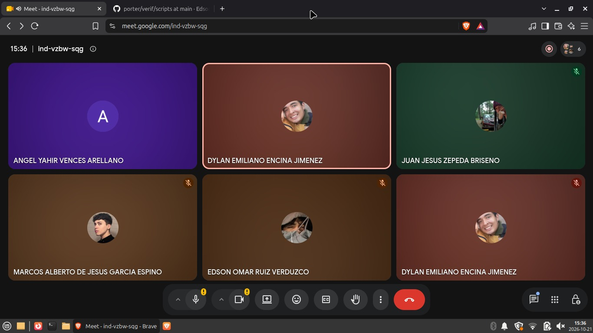

# Minuta — Junta 5

| | |
|---|---|
| **Fecha** | Miércoles 21 de octubre de 2026 |
| **Hora** | Alrededor de las 15:36 (según la evidencia) |
| **Medio** | Google Meet |
| **Asistentes visibles en la evidencia** | Angel Yahir Vences Arellano, Dylan Emiliano Encina Jimenez (dos conexiones), Juan Jesus Zepeda Briseno, Marcos Alberto de Jesus Garcia Espino, Edson Omar Ruiz Verduzco |

## Objetivo

Coordinar el Avance 02. _Temas tratados: por completar por el equipo._

## Lo que muestra la evidencia

| Imagen | Qué se ve |
|---|---|
| `junta5-01.png` | La llamada con los cinco integrantes; la barra de tareas muestra 2026-10-21 y hay una pestaña abierta en `porter/verif/scripts` |

## Actividad relacionada en el repositorio

- 20 y 21 de octubre: se abren los issues #35 a #48 del Avance 02.
- 21 de octubre: se agregan las 57 pruebas automatizadas a `verif/scripts/` (`bc11305`).
- 21 de octubre: se abre el PR #49 (persistencia) y Edson registra la línea base (PR #50).

## Acuerdos

_Por completar por el equipo._
